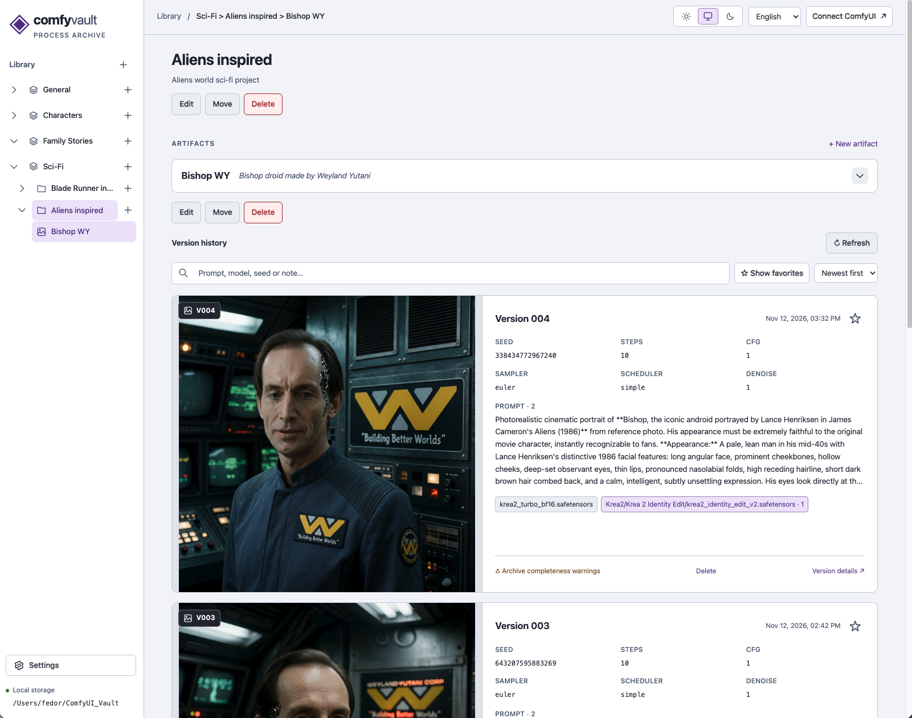
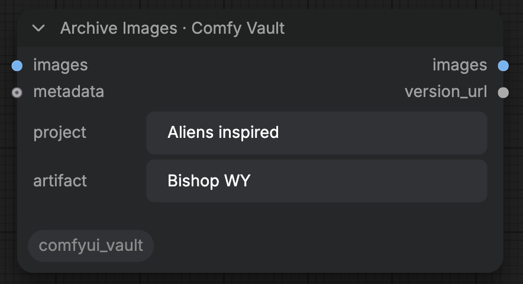

# Comfy Vault

**A portable history of your ComfyUI generations.**

Keep outputs, references, workflows, and generation parameters together in a local version archive.

[Quick start](#quick-start) · [User guide](QUICKSTART.md) · [Custom nodes](custom_nodes/comfyui_vault/README.md) · [API and format](FORMAT.md) · [Unlicense](LICENSE)



## Why Comfy Vault?

A useful result depends on more than an image: references, workflow changes, prompts, models, and seeds all matter. When these change between runs, saving the final image alone is not enough.

Comfy Vault saves iterations to disk and organizes them into **groups → projects → artifacts → versions**. Generate in ComfyUI, compare results in your browser, and return to any archived version of the process.

## Features

- **Automatic run snapshots.** Images or existing files, detected references, the visual workflow, API graph, and environment information.
- **Parameters alongside results.** Prompts, seeds, samplers, steps, CFG, models, LoRA names and strengths, plus computed values recorded with Capture Value.
- **An organized library.** A collapsible tree, names and descriptions, projects that move between groups, and artifacts that move between projects.
- **Browsing and comparison.** Full-resolution images, video playback, media navigation, search, notes, and favorites. Favorites also filter the media viewer.
- **A configurable interface.** Light, dark, and system themes; English, Russian, and Chinese; application-wide font sizing from 12 to 22 px.
- **Portable data.** SQLite and files in one directory, library switching, backup export, and backup import.
- **Local operation.** The application runs in Docker and needs neither a GPU nor copies of model weights.

> Model, encoder, VAE, and LoRA weights are **not copied**. Each version lists dependencies with expected paths, sizes, and SHA-256 hashes when available. Restoring a generation in ComfyUI is a manual process.

## Quick start

The primary setup is **macOS with Docker Desktop and ComfyUI on the same computer**. No browser extension is required.

From the project directory:

```bash
mkdir -p "$HOME/ComfyUI_Vault"
docker compose up -d --build
```

Open **[localhost:8088](http://127.0.0.1:8088)**. Data is stored in `$HOME/ComfyUI_Vault` by default, or `/Users/yourname/ComfyUI_Vault` on macOS.

On macOS, you can also double-click `start.command` or run:

```bash
bash ./start.command
```

The script starts Docker Desktop if needed, starts the application, and opens the browser. Start ComfyUI separately.

### Connect ComfyUI

1. Copy `custom_nodes/comfyui_vault` into `ComfyUI/custom_nodes/`, or download the package using **Connect ComfyUI** in the application.
2. Restart ComfyUI. The nodes appear in the **Comfy Vault** category.
3. Connect a finished `IMAGE` to **Archive Images** and enter `project` and `artifact` names.
4. Run the workflow. Once archiving succeeds, refresh the version history in the application.



If Save Image has no output, connect Archive Images to the same `IMAGE` input as Save Image. Archive Images writes its own PNG files. One node execution creates one version; the entire batch belongs to that version.

| Node | Use case |
| --- | --- |
| **Archive Images** | Archive an IMAGE batch with its graph, references, and parameters |
| **Archive Files** | Archive videos or existing files using paths or `VHS_FILENAMES`; use `after` to depend on the saving node |
| **Capture Value** | Record a computed seed, prompt, or another small JSON-compatible value |

Project and artifact names are matched exactly and are case-sensitive. Missing objects are created automatically. New projects enter General, or its renamed default-group equivalent. Project names are unique across the library; artifact names are unique within a project. Update the names in your workflow after renaming or moving the corresponding objects.

For details, see the **[user guide](QUICKSTART.md)** and **[custom-node documentation](custom_nodes/comfyui_vault/README.md)**.

## What a version contains

| Data | Contents |
| --- | --- |
| `outputs/` | Results passed to the archive node |
| `inputs/` | Detected input files from the relevant branch: references, masks, videos, and other files |
| `workflow.json` | The visual graph, if ComfyUI supplied its client-side workflow data |
| `prompt.json` | The complete execution API graph without the internal `is_changed` cache field |
| `metadata.json` | Recognized parameters, their sources, and explicitly captured values |
| `manifest.json` | Version number, file list, SHA-256 hashes, model paths, and warnings |
| `environment.json` | Python, packages, platform, and information about ComfyUI and custom nodes |
| `README.txt` | Manual restoration instructions |

Seeds retain their precision: API-graph seeds remain numbers, while large integers in browser-facing metadata are represented as strings. Computed values are not guessed. Use Capture Value when the graph contains only a link to another node.

### Restore an archived generation

1. Download the workflow and reference files from the selected version.
2. Install ComfyUI, the listed custom nodes, and the required models.
3. Place models and input files at the paths specified in the manifest.
4. Open the workflow, check the actual seeds, and set `control_after_generate` to **fixed**.
5. Verify the parameters and run the generation.

Identical seeds, graphs, and models do not guarantee bit-identical output across GPUs/MPS, PyTorch versions, or attention implementations.

## Storage and backups

```text
ComfyUI_Vault/
├── library.sqlite3
├── library.sqlite3-wal / library.sqlite3-shm  # while SQLite is active
├── projects/
│   └── PROJECT_ID/artifacts/ARTIFACT_ID/versions/
│       └── v000001_VERSION_ID/
│           ├── inputs/ and outputs/
│           ├── workflow.json and prompt.json
│           ├── metadata.json and manifest.json
│           └── environment.json and README.txt
└── .incoming/                               # temporary operations
```

The current library path appears at the bottom of the sidebar. **Settings → Repository** opens an existing library or creates one in an empty directory. Switching does not move your previous data. The selected location is stored in `.vault-location` inside the initial directory.

- **Export:** save a SQLite snapshot and indexed versions to a new or empty directory.
- **Import:** validate a backup and replace the current library after confirmation. Import replaces data; it does not merge libraries.
- **Manual transfer:** stop the application and copy the entire active directory, including SQLite and any remaining journals. Select that directory on the new computer.

Compose mounts your home directory at `/repositories` so the interface can select libraries and backup locations. Directory selection is currently limited to that mapping. External drives require additional mounts and path-mapping configuration. The application can access mounted directories: keep it local. Authentication and multi-user access are not implemented.

To change the initial location, create `.env` from [.env.example](.env.example) and set an absolute `VAULT_DATA_DIR`. Values in `.env` override Compose defaults.

## Interface

Click a preview to open the media viewer. Click the rest of a version card to open its files and parameters. **Show favorites**, search, and sorting determine the list used for media navigation.

**Settings** provides appearance, language, and application-wide font sizing with immediate feedback. These preferences are saved in the browser. User descriptions and prompts are not translated.

Deleting a group, project, or artifact also deletes its descendants and their version files. Versions can be deleted individually. The confirmation dialog focuses **Cancel**, and pressing Enter cancels the operation. Deletion is permanent; deleted version numbers are not reused.

## Updating

```bash
docker compose up -d --build
```

Reload the browser without its cached assets: **⌘⇧R** on macOS. If the custom nodes changed, replace your installed `comfyui_vault` package and restart ComfyUI. Back up your library before updating, and preserve your local `comfyui_vault.json` configuration.

## Development

The server uses Python 3.12+, FastAPI, and SQLite. The frontend uses HTML, CSS, and JavaScript without a build step. Node.js is needed for JavaScript checks.

```bash
python3 -m venv .venv
source .venv/bin/activate
python -m pip install -r requirements-dev.txt
python -m app --data-dir "$HOME/ComfyUI_Vault"
```

```bash
python -m unittest discover -s tests -v
node tests/test_ui.cjs
node --check app/static/app.js
node --check app/static/i18n.js
```

- [CONTRIBUTING.md](CONTRIBUTING.md): project structure and development workflow.
- [FORMAT.md](FORMAT.md): API, capture packages, and storage format.
- [VALIDATION.md](VALIDATION.md): verified scenarios and testing limitations.
- `python scripts/package.py /tmp/comfy-vault-release`: create source and custom-node ZIP packages.

## Limitations

Dependency detection targets standard loader nodes and common path fields. Custom loaders, network resources, embeddings in strings, hidden dependencies, and dynamic subgraphs may need an adapter or manual review. Check the version warnings and manifest before attempting restoration.

Do not modify source files while a generation is queued or running: capture happens when the archive node executes. The node archives its completed branch rather than waiting for other independent branches. If the archive server is unavailable, the node fails; deferred uploads are not implemented. Keep a regular Save Image node in the workflow as an additional output copy.

The package limit is 100 GB. Allow disk space for both the temporary ZIP and extracted files. Deduplication and automatic cleanup are not implemented. Video playback depends on browser codec support. Third-party custom-node source code and model weights are not included in archived versions.

## License

**[Unlicense](LICENSE)** — this code is dedicated to the public domain. You may use, modify, distribute, and sell it, including in closed-source commercial projects. The software comes without warranties. Third-party dependencies, models, and content retain their own terms.
